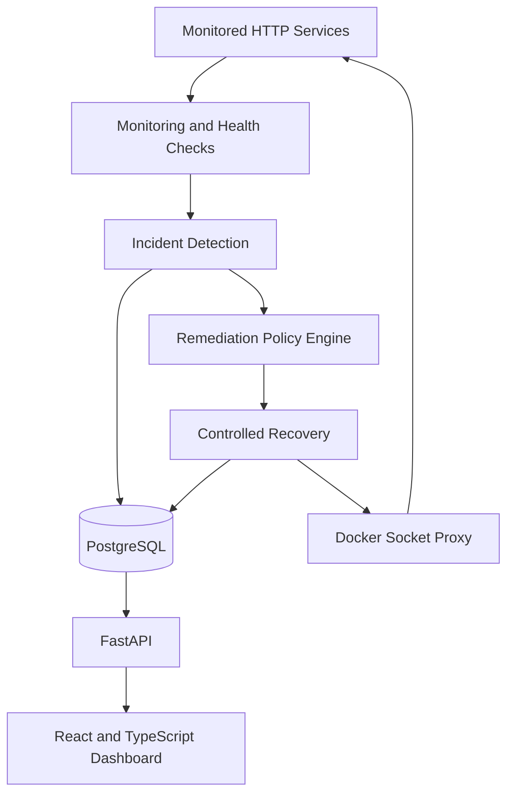
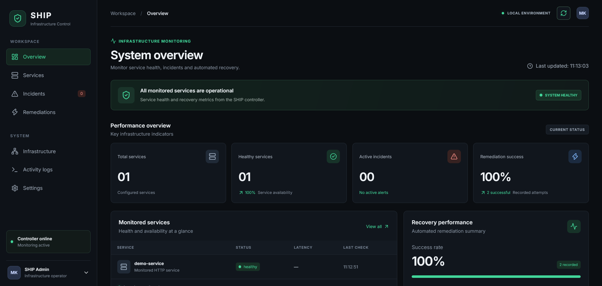

# SHIP — Self-Healing Infrastructure Platform

**A containerized infrastructure monitoring and self-healing prototype built with FastAPI, PostgreSQL, Docker Compose, React, and TypeScript.**

SHIP monitors configured services, detects failures, records incidents, executes controlled recovery actions, and verifies service health after remediation.

> **Project status:** Functional local prototype. The monitoring, incident lifecycle, automated container recovery, persistence, and dashboard have been tested locally. SHIP is not yet intended for production deployment.

## Features

- **Service monitoring:** HTTP health checks for configured services.
- **Incident management:** Detection, lifecycle tracking, and PostgreSQL persistence.
- **Automated remediation:** Policy-controlled recovery actions with retry and cooldown settings.
- **Recovery verification:** Health checks after remediation to determine whether a service has recovered.
- **Operational history:** Incident details and remediation attempts, including success and failure outcomes.
- **Web dashboard:** Service health, incident history, and recovery statistics.
- **REST API:** FastAPI endpoints for monitoring data and dashboard metrics.
- **Restricted Docker access:** A Docker Socket Proxy separates Docker Engine access from the dashboard-facing API.
- **Containerized environment:** Docker Compose for the backend, database, proxy, and monitored demo service.

## Architecture



The current implementation runs locally using Docker Compose. Kubernetes deployment and an extended observability stack remain future improvements.

## Technology Stack

| Area | Technology |
|---|---|
| Backend API | Python, FastAPI |
| Persistence | PostgreSQL, SQLAlchemy |
| Containerization | Docker, Docker Compose |
| Docker access isolation | Docker Socket Proxy |
| Frontend | React, TypeScript, Vite |
| UI icons | Lucide React |
| Testing | pytest |

## Prerequisites

- Docker Desktop with Docker Compose
- Node.js and npm
- Git

## Quick Start

### 1. Clone the repository

```bash
git clone https://github.com/malikLH44/self-healing-infrastructure-platform.git
cd self-healing-infrastructure-platform
```

### 2. Configure the environment

Create your local environment file:

```cmd
copy .env.example .env
```

Open `.env` and set `SHIP_DB_PASSWORD` to a strong local password. Do not commit `.env` or share real credentials.

### 3. Start the backend infrastructure

From the repository root, run:

```bash
docker compose --env-file .env -f infrastructure/compose/docker-compose.yml up -d --build
```

Check the container status:

```bash
docker compose --env-file .env -f infrastructure/compose/docker-compose.yml ps
```

### 4. Start the frontend

Open a second terminal:

```bash
cd frontend
npm install
npm run dev
```

Open the dashboard at **http://localhost:5173**.

### 5. Explore the API

- Dashboard API documentation: http://localhost:8000/docs
- API health: http://localhost:8000/health
- Demo service: http://localhost:8080

## Demonstrating Self-Healing

With the local environment running:

1. Open the dashboard and confirm the demo service is healthy.
2. Stop the demo container to simulate a service failure:

   ```bash
   docker stop ship-demo-service
   ```

3. Observe the incident detection and automatic remediation.
4. Verify that the container returns to operation and the incident is resolved in the dashboard.

The recovery process is asynchronous; allow the configured monitoring and recovery checks to run. Do not manually restart the demo container during the test.

## Production Build

From the `frontend/` directory:

```bash
npm run build
```

The frontend production build has been validated locally.

## Current Limitations and Roadmap

SHIP is an actively developed portfolio project. The current version focuses on a working local monitoring and recovery loop.

Planned improvements include:

- Containerizing the frontend for a unified deployment workflow.
- GitHub Actions CI for automated backend tests and frontend builds.
- Dashboard screenshots and repeatable resilience-test reports.
- Expanded observability and recovery performance measurements.
- Evaluation of a Kubernetes deployment.

Authentication, production hardening, and a full observability stack are not presented as completed features.

## Security Notes

- Run SHIP locally in an isolated development environment.
- Keep secrets in `.env`, never in source control.
- Docker Engine access is highly privileged; the socket proxy is a restriction layer, not a guarantee of complete isolation.
- Do not expose the prototype or its control interfaces directly to the public internet.

## Dashboard Preview




## License

This project is licensed under the MIT License. See [LICENSE](LICENSE).