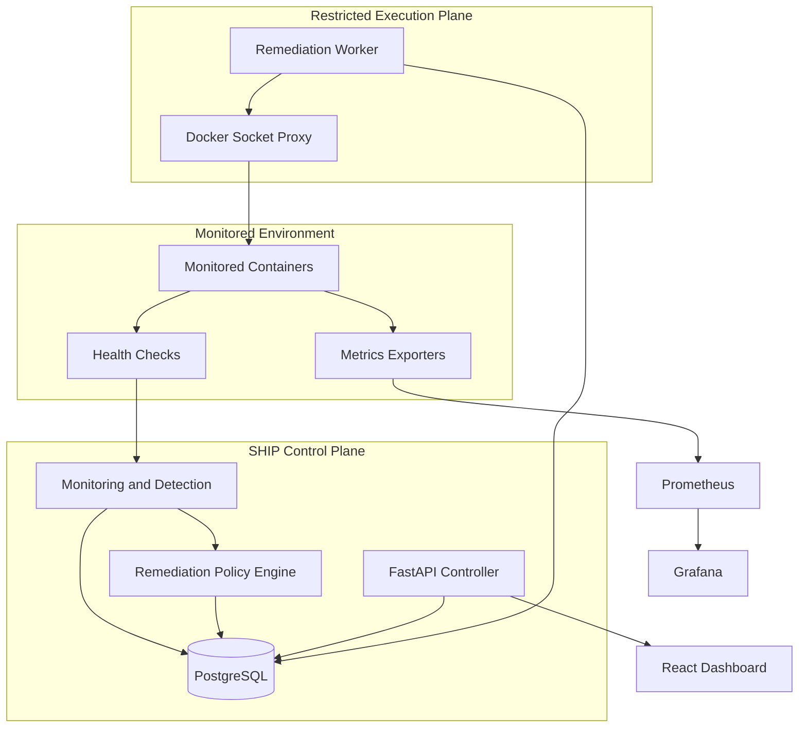

# System Architecture

## 1. Purpose

The Self-Healing Infrastructure Platform (SHIP) is designed to monitor services, detect operational incidents, execute authorized remediation actions, and verify recovery.

The initial deployment targets Docker Compose. The architecture should remain modular enough to support a future Kubernetes implementation.

The main design priorities are security, reliability, observability, and measurable recovery outcomes.

## 2. High-Level Architecture

SHIP follows a centralized-controller architecture. The controller coordinates monitoring, incident detection, remediation, and recovery verification.

The diagram represents the planned logical architecture. The implementation may combine some modules into fewer deployable components when appropriate.

## 3. Core Components

### 3.1 Monitored Services

The platform will monitor multiple independently configurable services running as containers.

Examples include:
- A sample HTTP API.
- A web application.
- A background worker.

Each service should have an appropriate health-check or monitoring configuration. Monitoring should not assume that every service exposes the same health endpoint.

### 3.2 Monitoring

The monitoring component collects service health and operational signals.

Initial monitoring capabilities:
- Container and service availability.
- Health-check results.
- CPU and memory usage where available.
- Basic network connectivity and latency checks.

Monitoring intervals, thresholds, and timeouts should be configurable. Transient failures should be handled carefully to avoid generating unnecessary incidents.

Prometheus is planned for metrics collection and storage.

### 3.3 Incident Detection

The detection component evaluates monitoring results against configured conditions.

Initial incident categories:
- Unexpected service termination.
- Repeated health-check failures or an unresponsive service.
- CPU or memory threshold violations.
- Network connectivity failures or excessive latency.

An incident should contain a unique identifier, affected service, category, severity, timestamps, and diagnostic details.

Where appropriate, the system should confirm persistent failures before creating an incident or triggering remediation.

### 3.4 Remediation Policy Engine

The policy engine determines whether an incident permits an automated action.

A policy may define:
- Applicable incident types and services.
- The permitted remediation action.
- Maximum retry count.
- Cooldown period.
- Verification timeout.
- Escalation behavior when recovery fails.

The initial implementation will prioritize a small set of predictable actions, such as restarting an eligible container.

Detection does not automatically imply remediation. Resource saturation and network failures may require an alert or further diagnosis instead of a restart.

### 3.5 Remediation Worker

The worker executes authorized remediation actions independently of the dashboard API.

Its responsibilities include:
- Validating the proposed action against policy.
- Enforcing retry limits and cooldown periods.
- Executing permitted container operations.
- Recording action results and errors.
- Preventing overlapping or repeated remediation attempts.

Access to the Docker Engine is highly privileged. The worker must therefore be isolated from the public-facing API, and its permissions should be restricted as far as the environment allows.

### 3.6 Recovery Verification

After a remediation action, the platform checks whether the affected service has recovered.

A successful recovery requires the configured health condition to pass within the verification timeout.

The incident lifecycle should distinguish between:
- Detected.
- Under investigation or awaiting remediation.
- Remediation in progress.
- Recovered.
- Unresolved or escalated.

The platform must not mark a service as recovered merely because a restart command completed successfully.

### 3.7 Controller API and Web Dashboard

The API, implemented with FastAPI, will expose authorized operations and provide incident, service-status, and remediation-history data to the dashboard.

The React and TypeScript frontend will display:
- Current service status.
- Active and historical incidents.
- Remediation actions and their outcomes.
- Recovery times and other resilience metrics.

Authentication and authorization will be enforced on the backend, not only in the frontend.

The API will not directly receive unrestricted Docker Engine access.

### 3.8 Persistence

PostgreSQL will store platform records such as:
- Incident metadata and lifecycle state.
- Remediation policies.
- Remediation attempts and outcomes.
- Audit events.
- Recovery measurements.

Metrics and logs may be stored in specialized observability systems rather than duplicated in the relational database.

### 3.9 Observability

The planned observability stack includes:
- **Prometheus:** metrics collection.
- **Grafana:** dashboards and visualization.
- **Loki:** centralized log aggregation.

The platform should correlate incidents with relevant monitoring data, remediation attempts, and timestamps to support diagnosis.

## 4. Incident Processing Workflow

The expected workflow is:

1. Collect service health and monitoring data.
2. Evaluate configured detection rules.
3. Confirm the incident when required.
4. Record the incident and its diagnostic context.
5. Evaluate the applicable remediation policy.
6. Reject or escalate actions that are not authorized.
7. Execute the permitted remediation action.
8. Verify recovery against the configured health condition.
9. Record the outcome and calculate recovery metrics.
10. Close the incident after confirmed recovery, or leave it unresolved and escalate when recovery fails.

The system should apply bounded retries, cooldowns, and duplicate-event handling to prevent remediation loops.

## 5. Security Architecture

Security is a core requirement from the beginning.

The initial design includes:
- Authenticated dashboard access.
- Backend-enforced authorization.
- Secrets stored outside source control.
- Input validation and safe API defaults.
- Audit records for remediation decisions and actions.
- Restricted access to the container engine.
- No arbitrary shell-command execution from user input.
- Resource limits and health checks for platform components where appropriate.

The Docker socket must be treated as a privileged interface. Mounting it into a container does not, by itself, provide meaningful isolation. The implementation should minimize which components can access it and which operations they can perform.

## 6. Deployment Strategy

### Phase 1: Docker Compose

The initial environment will contain the controller components, monitored sample services, and the dependencies needed for persistence and testing.

Monitoring and observability services will be introduced incrementally rather than all at once.

### Phase 2: Kubernetes

A later phase will evaluate deployment on Kubernetes using:
- Deployments and Services.
- Liveness, readiness, and startup probes where appropriate.
- Resource requests and limits.
- Kubernetes-native monitoring and recovery behavior.

The Kubernetes extension will compare SHIP's policy-driven remediation with native orchestration capabilities rather than duplicate functionality without justification.

## 7. Reliability and Evaluation

The platform will be evaluated through repeatable failure scenarios.

Planned measurements include:
- **Mean Time to Detect (MTTD):** time between the injected failure and incident detection.
- **Mean Time to Recover (MTTR):** time between failure onset and verified recovery, using a clearly documented measurement definition.
- Recovery success rate.
- Number of unsuccessful or repeated remediation attempts.
- Monitoring and remediation overhead.

Tests will initially use controlled, reproducible failures in an isolated environment.

## 8. Design Principles

1. **Least privilege:** grant each component only the access it needs.
2. **Controlled automation:** every remediation action must be explicitly permitted by policy.
3. **Verified recovery:** success is determined by health checks, not command execution alone.
4. **Fault tolerance:** handle monitoring errors and remediation failures safely.
5. **Observability:** retain enough context to explain incidents and decisions.
6. **Modularity:** separate responsibilities without introducing unnecessary services.
7. **Measurability:** validate resilience improvements through repeatable tests.